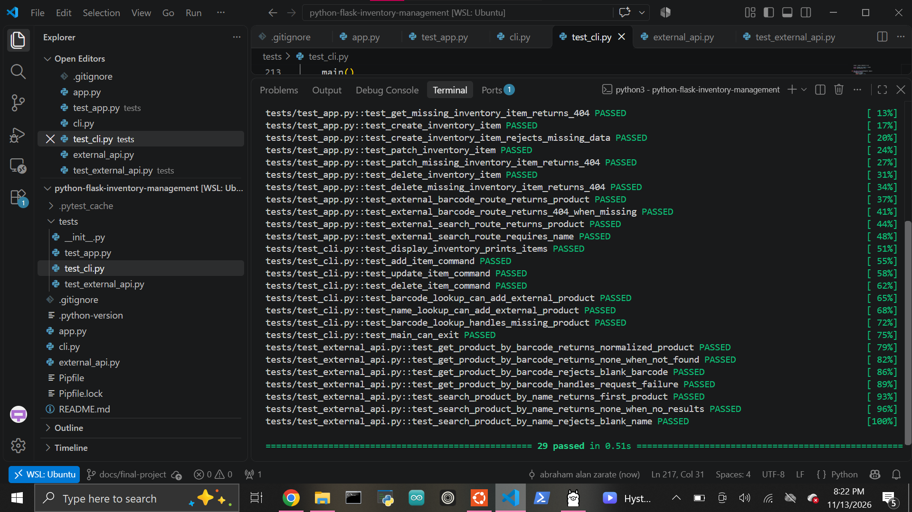
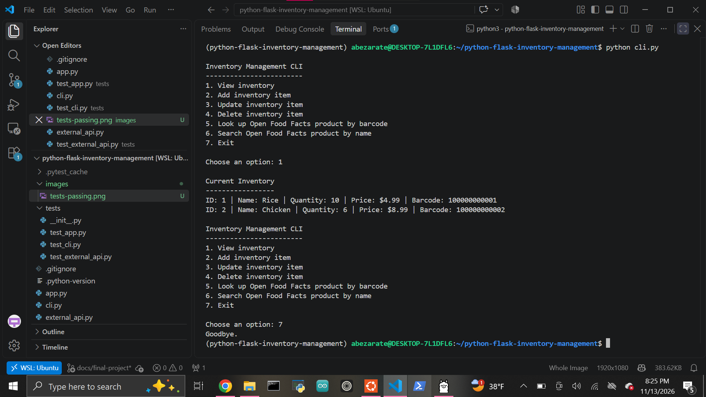

# Python Flask Inventory Management System

A command-line and REST API inventory management application built with Python, Flask, and Open Food Facts.

The project supports full CRUD operations, external product lookups, a user-facing CLI, automated testing, and Git feature-branch workflows.

## Features

This project includes:

- Flask REST API
- Full inventory CRUD operations
- In-memory inventory storage
- Product lookup by barcode
- Product search by name
- Open Food Facts integration
- Command-line inventory management
- Ability to add Open Food Facts products into local inventory
- Input validation
- Error handling
- Automated tests with pytest
- Mocked external API tests
- Git feature branches and pull requests

## Technologies

- Python 3.12
- Flask
- Requests
- Pytest
- unittest.mock
- Pipenv
- Git
- GitHub
- Open Food Facts API

## Project Structure

```text
python-flask-inventory-management/
├── images/
│   ├── cli-working.png
│   └── tests-passing.png
├── tests/
│   ├── __init__.py
│   ├── test_app.py
│   ├── test_cli.py
│   └── test_external_api.py
├── .gitignore
├── app.py
├── cli.py
├── external_api.py
├── Pipfile
├── Pipfile.lock
└── README.md
```

## Setup

Clone the repository:

```bash
git clone git@github.com:Abraham-z14/python-flask-inventory-management.git
cd python-flask-inventory-management
```

Install dependencies:

```bash
pipenv install
```

Enter the virtual environment:

```bash
pipenv shell
```

Confirm the Python version:

```bash
python --version
```

This project uses Python 3.12.

## Running the Flask API

Start the Flask application with:

```bash
python app.py
```

The API runs at:

```text
http://127.0.0.1:5000
```

## Inventory API Routes

### GET /

Returns a welcome message.

Example:

```bash
curl http://127.0.0.1:5000/
```

### GET /inventory

Returns all inventory items.

Example:

```bash
curl http://127.0.0.1:5000/inventory
```

### GET /inventory/<id>

Returns one inventory item by ID.

Example:

```bash
curl http://127.0.0.1:5000/inventory/1
```

If the item does not exist, the API returns:

```text
404 Not Found
```

### POST /inventory

Creates a new inventory item.

Example:

```bash
curl -X POST \
  -H "Content-Type: application/json" \
  -d '{
    "name": "Milk",
    "quantity": 4,
    "price": 3.49,
    "barcode": "123456789"
  }' \
  http://127.0.0.1:5000/inventory
```

A successful request returns:

```text
201 Created
```

Required fields are:

```text
name
quantity
price
```

### PATCH /inventory/<id>

Updates selected inventory fields.

Example:

```bash
curl -X PATCH \
  -H "Content-Type: application/json" \
  -d '{
    "quantity": 20,
    "price": 5.49
  }' \
  http://127.0.0.1:5000/inventory/1
```

A successful update returns:

```text
200 OK
```

### DELETE /inventory/<id>

Deletes an inventory item.

Example:

```bash
curl -X DELETE \
  http://127.0.0.1:5000/inventory/2
```

A successful deletion returns:

```text
204 No Content
```

## External Product Routes

The application connects to Open Food Facts for product information.

### GET /external/barcode/<barcode>

Looks up a product by barcode.

Example:

```bash
curl http://127.0.0.1:5000/external/barcode/3017624010701
```

Example response:

```json
{
  "name": "Nutella",
  "barcode": "3017624010701",
  "brand": "Ferrero",
  "category": "Spreads",
  "source": "Open Food Facts"
}
```

### GET /external/search?name=<product>

Searches Open Food Facts by product name.

Example:

```bash
curl "http://127.0.0.1:5000/external/search?name=Nutella"
```

## Open Food Facts Integration

External product logic is implemented in `external_api.py`.

The application supports:

- barcode lookup
- product-name search
- normalized external product data
- network error handling
- missing-product handling

External products are normalized into fields such as:

```text
name
barcode
brand
category
source
```

The CLI can use this data to add an external product into the local inventory.

Quantity and price are entered locally because they are inventory-specific values.

## Running the CLI

Start the command-line interface with:

```bash
python cli.py
```

The CLI provides:

```text
Inventory Management CLI
------------------------
1. View inventory
2. Add inventory item
3. Update inventory item
4. Delete inventory item
5. Look up Open Food Facts product by barcode
6. Search Open Food Facts product by name
7. Exit
```

## CLI Examples

### View Inventory

Choose:

```text
1
```

Example output:

```text
Current Inventory
-----------------
ID: 1 | Name: Rice | Quantity: 10 | Price: $4.99 | Barcode: 100000000001
ID: 2 | Name: Chicken | Quantity: 6 | Price: $8.99 | Barcode: 100000000002
```

### Add an Inventory Item

Choose:

```text
2
```

Then enter:

```text
Product name: Eggs
Quantity: 12
Price: 3.99
Barcode (optional): 12345
```

### Update an Inventory Item

Choose:

```text
3
```

Enter the inventory ID and any values that should change.

Leaving a value blank keeps the existing value.

### Delete an Inventory Item

Choose:

```text
4
```

Enter the inventory ID to remove.

### Look Up an External Product by Barcode

Choose:

```text
5
```

Enter a barcode.

If Open Food Facts finds the product, the CLI displays its product information and asks whether it should be added to local inventory.

### Search an External Product by Name

Choose:

```text
6
```

Enter a product name.

If a result is found, the CLI displays the external data and can add it to inventory.

## Input Validation

The REST API validates:

- required fields
- non-empty names
- non-negative quantities
- non-negative prices
- valid JSON data

The CLI also validates user-entered quantities, prices, IDs, and required values.

## Error Handling

The project returns meaningful errors for:

- missing inventory items
- invalid request data
- missing external products
- network failures
- invalid CLI input

Typical API status codes include:

```text
200 OK
201 Created
204 No Content
400 Bad Request
404 Not Found
502 Bad Gateway
```

## Testing

Run the complete automated test suite with:

```bash
python -m pytest -v
```

Current result:

```text
29 passed
```

The test suite covers:

- Flask inventory routes
- create, read, update, and delete behavior
- validation and 404 behavior
- Open Food Facts barcode lookups
- Open Food Facts product-name searches
- mocked network failures
- external helper routes
- CLI display behavior
- CLI create, update, and delete commands
- CLI external product lookup
- adding external products into inventory
- CLI exit behavior

## Mocking External Requests

The Open Food Facts tests use `unittest.mock`.

This allows the application to test API behavior without depending on a live internet connection.

The mocked tests verify both successful responses and failure cases.

## Test Evidence



## CLI Evidence



## Git Workflow

The project was developed using separate feature branches:

```text
feature/inventory-api
feature/openfoodfacts-api
feature/inventory-cli
docs/final-project
```

Each completed feature was merged into `main` through a pull request.

Finished feature branches were cleaned up after merging.

## Learning Outcomes

This project demonstrates how to:

- build a REST API with Flask
- implement full CRUD operations
- work with an in-memory data store
- validate JSON input
- integrate a third-party API
- normalize external data
- build a command-line interface
- use mocks for external-service testing
- organize tests by feature
- use Git branches and pull requests
- document a complete Python application

## Author

Abraham Zarate